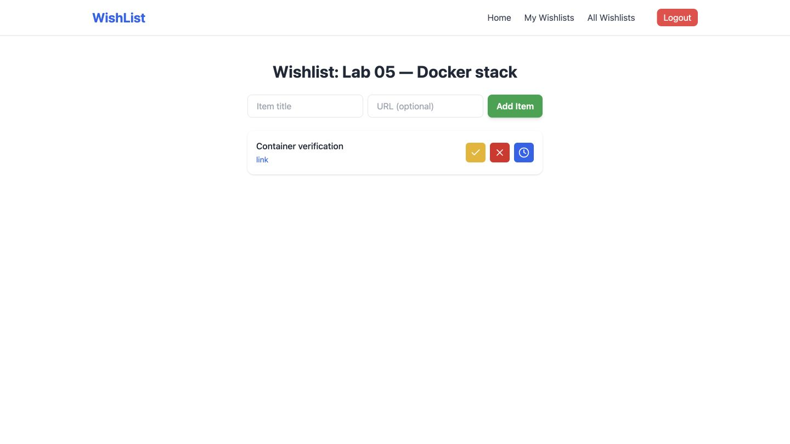
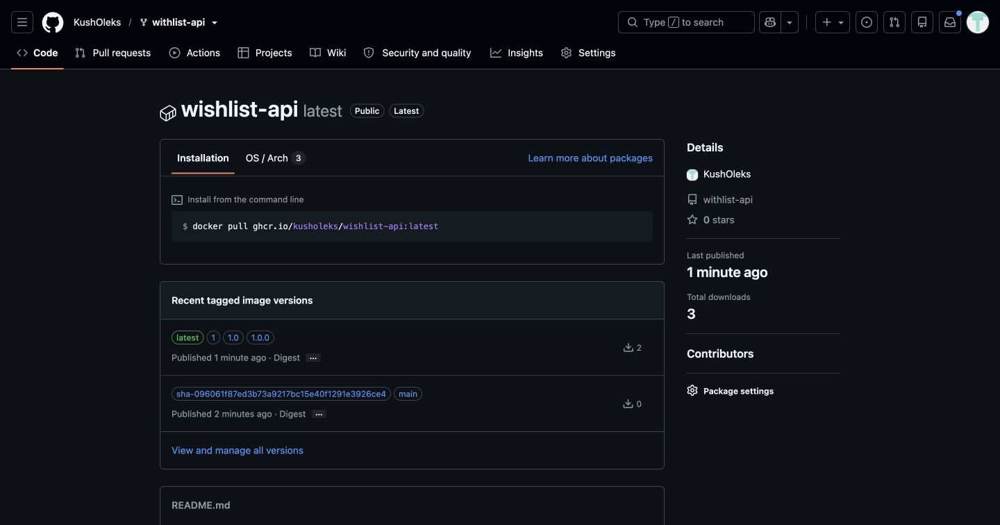

# Лабораторна №5 — контейнери API та спільний стек

## Запуск із чистого клону

Потрібні Git і Docker Desktop з Compose 2.24.4 або новішим. На Linux потрібний Docker Engine з Compose plugin.

```bash
mkdir -p ~/DevOps/lab-05
cd ~/DevOps/lab-05
git clone https://github.com/KushOleks/withlist-api.git
git clone https://github.com/KushOleks/wishlist-ui.git
cd withlist-api
cp .env.example .env
```

У `.env` заповніть `POSTGRES_PASSWORD` і `SECRET_KEY` різними випадковими значеннями.
Для кожного можна використати `openssl rand -hex 32`. Секрети не комітяться й не передаються в build args.
`API_PORT=8000`, `UI_PORT=8080`, `VITE_API_BASE=http://localhost:8000` підходять для запуску на цій машині.
Якщо змінюєте UI_PORT, змініть також ALLOWED_ORIGINS. Якщо змінюєте API_PORT, змініть VITE_API_BASE й перебудуйте UI.

```bash
docker compose config --quiet
docker compose up -d --build
docker compose ps
curl --fail http://localhost:8000/health
```

UI: http://localhost:8080; API Swagger: http://localhost:8000/docs.
Створіть користувача й список у UI. API і UI мають опубліковані порти лише на loopback.
PostgreSQL та Redis не мають host ports. Кожен сервіс має healthcheck та restart: unless-stopped.
API залежить від здорових PostgreSQL і Redis, UI — від здорового API.
Compose відхиляє відсутній/порожній POSTGRES_PASSWORD або SECRET_KEY через `${VAR:?message}`.

На Mac із попередньою лабораторною поточні приватні значення збережені окремо в `.env.lab05`:
для цього середовища використовуйте `docker compose --env-file .env.lab05 ...`.
Том старої лабораторної не використовується: новий проект має ім’я lab05-wishlist.

## Образ API

Python 3.12.12-slim-bookworm, залежності встановлюються до копіювання коду з --no-cache-dir і --require-hashes за requirements-runtime.txt.
Процес працює від appuser (UID 10001), слухає 0.0.0.0:8000, CMD має exec-форму.
Копіюються лише потрібні Python-модулі. .dockerignore виключає env-файли, Git, тести й кеші.
Конфігурація БД, JWT, Redis і CORS надходить тільки зі змінних середовища.

## Перевірки та докази

На Mac M1 перевірено: appuser, відсутність .env/.git/tests у /app,
усі чотири сервіси healthy, порти PostgreSQL/Redis не опубліковані.
API stop: **0,567 секунди**. Після додавання одного коментаря до main.py шар pip install
має CACHED; початковий файл відновлено. [Повний лог кешу](containers-assets/api-cache-proof.log).

[Повний лог перевірки тому](containers-assets/volume-proof.log):
- POST /wishlists створив запис id=1 з title `Lab05 named volume proof`;
- після down та up GET /wishlists/1 повернув 200 із тим самим title;
- після down -v та up GET /wishlists/1 повернув 404: видалено named volume лише disposable project.
Робочий lab05-wishlist та старий lab04-wishlist не видалялися.

Через браузер створено користувача, список і бажання у контейнерному UI.
Оновлення глибокого маршруту /wishlists/1 зберігає сторінку й дані:


[Реліз v1.0.0](https://github.com/KushOleks/withlist-api/releases/tag/v1.0.0) опублікований.
[Публічний пакет](https://github.com/KushOleks/withlist-api/pkgs/container/wishlist-api)
має теги main, sha-<повний коміт>, 1.0.0, 1.0, 1 та latest.



[Повний manifest](containers-assets/release-manifest.txt) містить linux/amd64 і linux/arm64
під одним тегом 1.0.0. Digest індексу:
`sha256:b9bcbc60371420bea46e35abb04dcbc6cd173de48c4a4afe85d305b029a6fdb0`.
unknown/unknown записи є attestations, а не додатковими архітектурами.
[Анонімний pull](containers-assets/anonymous-pull.txt) виконано з порожнім DOCKER_CONFIG
без auth; docker login не виконувався.
[Релізний CI](https://github.com/KushOleks/withlist-api/actions/runs/45497369021).


```bash
docker run --rm wishlist-api:lab05-local whoami
docker run --rm wishlist-api:lab05-local ls -a
docker build --progress=plain -t wishlist-api:lab05-local .
docker buildx imagetools inspect ghcr.io/kusholeks/wishlist-api:1.0.0
```

Для перевірки тому використовується окремий disposable project `lab05-volume-proof`.
`down` залишає його named volume; `down -v` видаляє саме тестові дані цього project.
Робочий том і старий стек лабораторної №4 не видаляються.

## Режим розробки

```bash
docker compose -f compose.yaml -f compose.dev.yaml --profile dev up --build --watch
```

Після зміни вимог оновіть lock: `uv pip compile requirements.txt --python-version 3.12 --universal --generate-hashes -o requirements-runtime.txt`.

API використовує develop.watch: sync+restart для коду й rebuild для requirements.txt.
Dockerignore не дає синхронізувати .env та Git. UI монтує вихідний каталог у /app,
але /app/node_modules перекритий окремим named volume: host-залежності не замінюють Linux-залежності.
При старті dev UI виконується npm ci, тому вміст тому відповідає lock-файлу.
Зміни Vue-компонентів підхоплює Vite без docker compose build.

## CI, GHCR та сканування

Job API image (Docker) залежить від тестів. На PR збірка перевіряється без push у GHCR;
на main публікуються main і sha-<повний SHA>; на v* — version, major.minor, major та latest.
Для main/release публікуються linux/amd64 і linux/arm64 під одним тегом.
Вхід у GHCR — GITHUB_TOKEN, permissions задаються явно, PAT не використовується.
Окремий advisory job Trivy не входить до required checks; JSON-звіт зберігається артефактом.
У Summary цього job автоматично порівнюються OS-пакети та бібліотеки застосунку.

## Trivy — контрольний PR-прогін

[API CI 45494531646](https://github.com/KushOleks/withlist-api/actions/runs/45494531646)
містить артефакт wishlist-api-trivy. JSON дав 512 записів у OS-пакетах та 52 у Python-залежностях.
Більшість знахідок походить із базового OS-образу. Це кількість записів пакет/CVE,
а не унікальних CVE; результат залежить від дати бази Trivy.

## Бонус 1 — перевірений режим розробки

На тому самому Docker engine фактично перевірено:
- зміна відповіді /health синхронізувалася через Compose Watch і restart; image ID API не змінився;
- зміна тексту Welcome.vue з’явилася у відповіді Vite; image ID UI не змінився;
- додавання коментаря до requirements.txt запустило rebuild та recreate API, image ID змінився.
Після перевірки вихідні файли відновлено. Dev-образи мають окремі теги lab05-dev,
тому не перезаписують production lab05-local.

## Завдання 5 — діагностика невідомої поломки

Оператор обрав поломку інтерактивним scripts/diagnostic-exercise.py в окремому
project lab05-diagnostic і не повідомляв другий вибір до завершення діагностики.
Файл із вибором не читався; перевірялися фактичні симптоми запущеного контейнера.

Знайдена причина: Uvicorn слухав **127.0.0.1:8000 всередині контейнера**.
Це крок 3 чеклиста лекції 5 «Сервіс піднявся, але недоступний»: перевірити bind-адресу.

Фактичні спостереження:

```text
$ curl --max-time 5 -s -o /dev/null -w 'External API HTTP=%{http_code}\n' http://localhost:19000/health
External API HTTP=000
$ docker compose -p lab05-diagnostic --env-file .env.lab05 -f compose.yaml ps
api  Up (healthy)  127.0.0.1:19000->8000/tcp
postgres  Up (healthy)
redis  Up (healthy)
ui  Up (healthy)  127.0.0.1:19080->80/tcp
$ docker port lab05-diagnostic-api-1
8000/tcp -> 127.0.0.1:19000
$ docker inspect lab05-diagnostic-api-1 --format 'State={{.State.Status}} Health={{.State.Health.Status}} RestartCount={{.RestartCount}}'
State=running Health=healthy RestartCount=0
$ docker exec lab05-diagnostic-api-1 python -c "import urllib.request; print(urllib.request.urlopen('http://127.0.0.1:8000/health').status)"
200
$ docker exec lab05-diagnostic-api-1 python -c "from pathlib import Path; print(Path('/proc/1/cmdline').read_bytes().replace(bytes([0]),b' ').decode())"
/usr/local/bin/python /usr/local/bin/uvicorn main:app --host 127.0.0.1 --port 8000
```

У /proc/net/tcp для порту 8000 був LISTEN `0100007F:1F40` — IPv4 loopback.
Healthcheck теж звертається до loopback, тому був зеленим і не доводив зовнішню доступність.
Виправлення: повторний up API лише з базовим compose.yaml відновив CMD із --host 0.0.0.0.
Після виправлення зовнішній GET http://localhost:19000/health повернув 200 і redis=healthy.
Для slim-образу без ss/netstat використано /proc/1/cmdline та /proc/net/tcp.

## Примітка щодо Docker Compose на Mac

У встановленому Compose 5.0.2 після успішних Watch-перевірок завершення watch через Ctrl+C
одного разу завершилося upstream panic `close of closed channel`. Код синхронізувався,
rebuild вимог відпрацював; production стек після цього повторно перевірено через up --wait.
Це спостереження про CLI на Mac, а не про роботу контейнерів.
